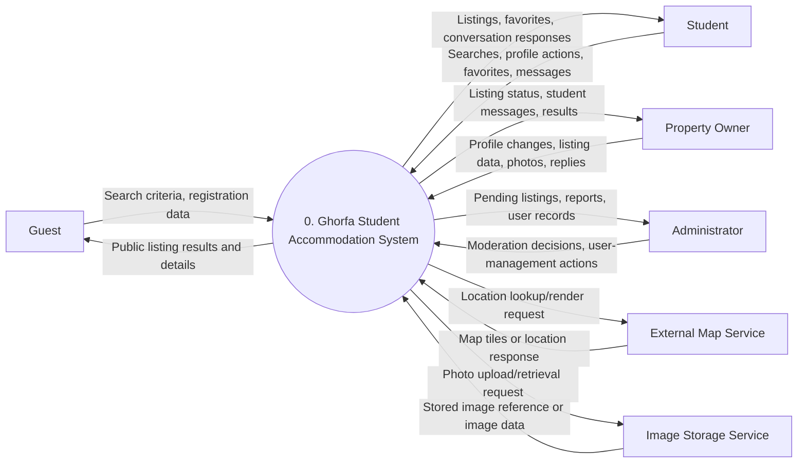
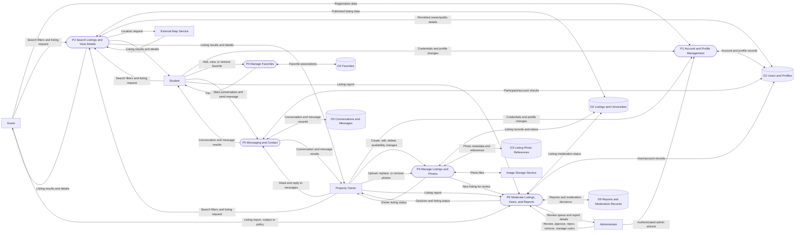
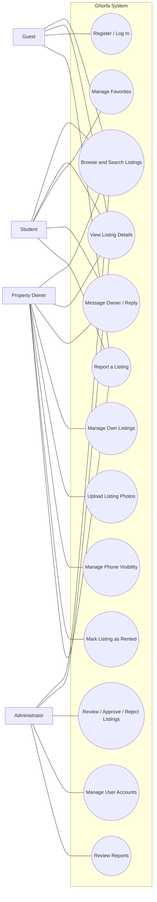
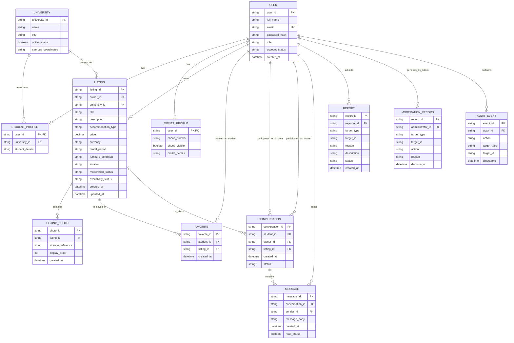

# Ghorfa — Student Accommodation Platform

**Ghorfa** is a web-based student accommodation platform designed to connect university students directly with property owners, without brokers. It helps students discover rooms and apartments, compare listing information, and contact owners. The initial target deployment described in the SRS is the Egypt-Japan University of Science and Technology (E-JUST) in New Borg El Arab, Egypt.

> **Project scope note:** The feature descriptions and diagrams in this README document the intended system defined by the Software Requirements Specification (SRS). The repository structure currently shown is a frontend-oriented project (`HTML`, `CSS`, and JavaScript). The supplied folder view does not establish that backend services, persistent storage, authentication, messaging, maps, or every SRS requirement have been implemented. Treat those as product requirements until their implementation is confirmed.

## Table of Contents

- [Project Goals](#project-goals)
- [User Roles](#user-roles)
- [Functional Requirements](#functional-requirements)
- [Non-Functional Requirements](#non-functional-requirements)
- [Scope and Limitations](#scope-and-limitations)
- [Repository Structure](#repository-structure)
- [Run Locally](#run-locally)
- [Conceptual System Architecture](#conceptual-system-architecture)
- [System Diagrams](#system-diagrams)
  - [DFD — Context Diagram (Level 0)](#dfd--context-diagram-level-0)
  - [DFD — Main Processes (Level 1)](#dfd--main-processes-level-1)
  - [Use Case Diagram](#use-case-diagram)
  - [ERD — Logical Data Model](#erd--logical-data-model)
  - [Sequence Diagram — Student Sends a Message](#sequence-diagram--student-sends-a-message)
  - [Sequence Diagram — Listing Review](#sequence-diagram--listing-review)
- [Core Data Entities](#core-data-entities)
- [Important Business Rules](#important-business-rules)
- [Open Design Decisions](#open-design-decisions)
- [License](#license)

## Project Goals

- Provide one organized place for students to browse accommodation listings associated with a university.
- Let students filter listings by university, maximum price, accommodation type, and furniture condition.
- Give owners a way to create and maintain their own accommodation listings.
- Support direct student–owner communication and student favorites.
- Improve listing quality through administrative review and reporting workflows.
- Protect personal information, especially owner phone-number visibility and private conversations.

## User Roles

| Role | Main capabilities |
|---|---|
| **Guest** | Browse and search public listings, view public listing details, and register as a student or owner. |
| **Student** | Browse and filter listings, manage personal favorites, and start or participate in conversations with owners. |
| **Property Owner** | Browse listings, manage only their own listings, upload listing photographs, control public phone-number visibility, mark accommodation as rented, and reply to students. |
| **Administrator** | Review listings, approve or reject submissions, manage user accounts, and review reports or inappropriate content. |

Protected actions must be authorized according to the user's role. Hiding a control in the interface alone is not sufficient; the SRS requires permission checks on the server side.

## Functional Requirements

The following summary is based on the functional-requirement groups in the SRS. Requirement IDs are included to make the README traceable to the specification.

| Area | SRS requirement IDs | Required system behavior |
|---|---|---|
| **Registration and authentication** | `FR-AUTH-001`–`FR-AUTH-010` | Allow guest registration as a student or owner; validate required fields; prevent duplicate email registration; support login and logout; enforce role-based access; protect restricted areas; provide account recovery; and provision administrator accounts without public administrator self-registration. |
| **User profiles** | `FR-PROF-001`–`FR-PROF-005` | Allow students and owners to view their profiles, update permitted information, protect account identifiers and role assignments, and initiate account deletion or deactivation requests. |
| **Browsing, search, and filtering** | `FR-SRCH-001`–`FR-SRCH-010` | Let guests and authenticated users browse published listings; filter by university, maximum price, accommodation type, and furniture condition; combine active filters; show empty states; reset filters; display listing summaries; and exclude listings not eligible for public display. |
| **Listing details** | `FR-ROOM-001`–`FR-ROOM-008` | Display listing description, price and rental period, accommodation type, furniture condition, photographs, availability, map location when available, and owner contact information only when permitted by the owner's visibility setting. |
| **Listing management** | `FR-LIST-001`–`FR-LIST-012` | Allow authenticated owners to create, view, edit, and request deletion of their own listings; validate listing data; associate each listing with its owner; submit new listings for review; show moderation and availability status; and mark a listing as rented. |
| **Listing photographs** | `FR-IMG-001`–`FR-IMG-005` | Allow owners to upload, remove, or replace photographs for their own listings; associate each photograph with the correct listing; validate file type and size; and report upload failures. |
| **Favorites** | `FR-FAV-001`–`FR-FAV-005` | Allow authenticated students to add, view, and remove favorites; prevent duplicate student–listing entries; and restrict access to the student's own favorites. |
| **Internal messaging and owner contact** | `FR-MSG-001`–`FR-MSG-009` | Allow students to initiate conversations with listing owners; allow owners to view and reply to their conversations; associate messages with a sender, conversation, and timestamp; restrict conversations to their participants; report sending failures where supported; and respect owner phone visibility preferences. Ghorfa does not require the rental transaction to take place through the platform. |
| **Location and maps** | `FR-MAP-001`–`FR-MAP-004` | Store or reference listing locations; display them through the configured map service when valid; provide feedback when a map cannot be displayed; and avoid disclosing more precise location data than permitted. |
| **Administration and moderation** | `FR-ADM-001`–`FR-ADM-010` | Restrict administrative actions to authorized administrators; provide a review queue; support listing approval, rejection, and removal; support user management; record moderation decisions and timestamps; and capture rejection/removal reasons where required by the approved policy. |
| **Reporting** | `FR-REP-001`–`FR-REP-004` | Provide an authorized way to report fake, misleading, or inappropriate listings; allow administrators to review reports and record outcomes; and restrict report access. The precise reporting policy remains subject to an open SRS decision. |
| **Notifications** | `FR-NOTIF-001`–`FR-NOTIF-003` | The SRS identifies optional notifications for new messages, listing approval/rejection, and owner replies. These are stated as **may** requirements, not confirmed mandatory functionality. |

## Non-Functional Requirements

These requirements describe the expected quality and operating characteristics of the system.

| Quality attribute | SRS requirement IDs | Requirement summary |
|---|---|---|
| **Performance** | `NFR-PERF-001`–`NFR-PERF-004` | Under the agreed test environment and load profile, 95% of ordinary page and search requests should complete within **3 seconds**, excluding third-party map rendering and large image transfers. Large result sets must be bounded through pagination or an equivalent mechanism; images should be optimized; and search results must reflect the active filters without stale results. |
| **Security** | `NFR-SEC-001`–`NFR-SEC-008` | Hash passwords using a recognized method; enforce role-based authorization and listing ownership checks; restrict messages to participants; use HTTPS in deployment; safely validate user text and uploaded files; protect credentials and session tokens; and apply reasonable protection against repeated automated login attempts. |
| **Privacy** | `NFR-PRIV-001`–`NFR-PRIV-005` | Show an owner's phone number only when enabled; restrict private profiles, favorites, and conversations to authorized users; collect only necessary information; never expose credentials in admin views or normal responses; and define a retention/deletion policy before production. |
| **Usability and accessibility** | `NFR-USE-001`–`NFR-USE-006` | Use consistent navigation and interaction patterns; identify required form fields; provide understandable validation and empty/loading/success/error states; give controls accessible names; maintain sufficient contrast and visible keyboard focus; and support keyboard navigation for primary workflows. |
| **Compatibility and responsiveness** | `NFR-COMP-001`–`NFR-COMP-004` | Support the agreed current major versions of Chrome, Edge, Firefox, and Safari; remain usable from **320 CSS pixels** wide and above; adapt to desktop, tablet, and mobile without ordinary-content horizontal overflow; and avoid making essential controls hover-only. |
| **Reliability and availability** | `NFR-REL-001`–`NFR-REL-005` | Report critical failures accurately; preserve successfully saved information across sessions; define production backup and restoration; allow listing details to remain accessible when the map service is unavailable; and handle image-storage failures without falsely reporting a successful photograph upload. |
| **Maintainability** | `NFR-MAINT-001`–`NFR-MAINT-003` | Separate presentation, application behavior, and data-access responsibilities; document configuration, deployment, and essential administration; and use consistent naming and code organization. |
| **Scalability** | `NFR-SCALE-001`–`NFR-SCALE-002` | Allow additional universities without redesigning the core listing model; support growth through pagination, indexed search fields, and separable image storage where appropriate. |
| **Localization** | `NFR-LOC-001`–`NFR-LOC-003` | Initially present prices in Egyptian pounds (EGP), subject to confirmation of the rental-price policy; design for Arabic and English; and support right-to-left layout when Arabic is enabled. |

## Scope and Limitations

### Included in the SRS scope

- Public discovery and filtering of published accommodation listings.
- Student and property-owner accounts with role-based access.
- Listing details, photographs, and map-based location display.
- Student favorites and internal student–owner messaging.
- Owner listing management and phone-number visibility control.
- Administrative listing moderation, user management, and report handling.

### Explicitly out of scope for the initial release

- Online rent payments, deposits, refunds, or payment reconciliation.
- Online rental contracts, electronic signatures, or legal verification of rental agreements.
- Automated legal verification of property ownership.
- Native iOS or Android applications.
- Expansion beyond the initial university area.

Students and owners arrange property visits, payments, and rental agreements independently outside Ghorfa. The platform must not present a listing or owner as legally verified unless a separate verification process exists.

## Repository Structure

The following tree reflects the repository layout visible in the supplied project screenshot:

```text
Ghorfa/
├── .vscode/        # Visual Studio Code project settings
├── css/            # Stylesheets
├── imgs/           # Project images and visual assets
├── pages/          # Additional HTML pages
├── index.html      # Main page
├── main.js         # Main JavaScript file
├── LICENSE         # License information
└── README.md       # Project documentation
```

The project files shown indicate a browser-based frontend using HTML, CSS, and JavaScript. The exact backend framework, database technology, authentication provider, map provider, and image-storage provider are not specified in the SRS and should not be assumed from this directory tree.

## Run Locally

This repository snapshot does not show a package manifest or build configuration. For a basic frontend preview:

1. Clone the repository:

   ```bash
   git clone https://github.com/anasihashem/web-project.git
   ```

2. Open the cloned `Ghorfa` project folder in Visual Studio Code.
3. Open `index.html` in a browser, or use a local static-server extension such as **Live Server** in VS Code.

If the application later relies on backend APIs, authentication, database access, maps, or remote image storage, those services must also be configured. Their setup commands and environment variables should be documented here once the implementation choices are finalized. Do not put API keys, passwords, or other secrets in this repository.

## Conceptual System Architecture

The SRS describes the following logical architecture. It is a conceptual model, not confirmation of the currently implemented deployment:

1. **Browser interface** — pages and controls used by guests, students, owners, and administrators.
2. **Application services** — account/profile management, search, listing management, favorites, messaging, and moderation.
3. **Persistent data store** — users, listings, photographs' metadata, favorites, conversations, messages, reports, and moderation records.
4. **Image storage and delivery** — stores and serves listing photographs.
5. **External mapping service** — renders the location associated with a listing.

## System Diagrams

The diagrams below are written in Mermaid. GitHub renders Mermaid code blocks directly in Markdown, so the diagrams should appear when this README is viewed on GitHub.

### DFD — Context Diagram (Level 0)

This context diagram shows Ghorfa as one system and the external actors/services exchanging information with it.



### DFD — Main Processes (Level 1)

This Level 1 DFD decomposes Ghorfa into the main processes and logical data stores identified in the SRS. The data stores are conceptual; the SRS does not select a physical database or storage provider.



### Use Case Diagram

This UML-style use case view summarizes the interactions specified for the four SRS actors. Reporting by guests and some reporting-policy details remain subject to stakeholder confirmation.



### ERD — Logical Data Model

The ERD models the SRS's core entities, primary keys (PKs), foreign keys (FKs), and principal relationships. It is a **logical** model; the physical schema and database technology remain implementation decisions.



**ERD notes and constraints**

- `USER.email` must be unique.
- A `FAVORITE` must reference an existing student and listing. The `(student_id, listing_id)` pair must be unique to prevent duplicate favorites.
- Each listing belongs to one owner account and references a supported university or an explicitly permitted location category.
- Each photograph references the listing to which it belongs.
- Each message references a conversation and an authorized participant as its sender.
- Conversation access is restricted to its student and owner participants.
- `REPORT.target_type` / `target_id`, `MODERATION_RECORD.target_type` / `target_id`, and `AUDIT_EVENT.target_type` / `target_id` represent the target record. The SRS describes report targets as potentially being listings or users, so these target references are modeled generically rather than as a single direct foreign key.
- `STUDENT_PROFILE` and `OWNER_PROFILE` are shown as optional one-to-one entities for clarity. The SRS leaves open whether these should be separate tables or role-specific attributes on `USER`; finalize this choice during database design.

### Sequence Diagram — Student Sends a Message

The sequence follows the SRS requirement to authenticate the sender, verify conversation participation, persist the message, and return a success or failure result. It does not assume real-time push infrastructure.

```mermaid
sequenceDiagram
    autonumber
    actor Student
    participant UI as Browser / Student UI
    participant App as Application Service
    participant Auth as Authorization and Conversation Service
    database DB as Database
    participant OwnerUI as Owner Interface

    Student->>UI: Open a listing and compose a message
    UI->>App: Submit message and conversation details
    App->>Auth: Validate session and requested conversation
    Auth->>DB: Load conversation and participant records
    DB-->>Auth: Conversation and participant data

    alt Student is not authenticated or is not a participant
        Auth-->>App: Reject request
        App-->>UI: Return authorization error
        UI-->>Student: Show error feedback
    else Student is an authorized participant
        Auth->>DB: Save message with sender, conversation, and timestamp
        alt Message saved successfully
            DB-->>Auth: Saved message record
            Auth-->>App: Message accepted
            App-->>UI: Return success and message data
            UI-->>Student: Display sent message
            Note over OwnerUI,DB: The owner can retrieve the message when opening the conversation; no push delivery is assumed.
            OwnerUI->>App: Open the conversation
            App->>Auth: Verify owner is a participant
            Auth->>DB: Retrieve conversation messages
            DB-->>Auth: Authorized messages
            Auth-->>App: Conversation data
            App-->>OwnerUI: Display conversation
        else Message persistence fails
            DB-->>Auth: Save failure
            Auth-->>App: Message was not saved
            App-->>UI: Return failure response
            UI-->>Student: Show sending failure
        end
    end
```

### Sequence Diagram — Listing Review

This sequence covers owner submission, placement in the moderation queue, an administrator's decision, and persistence of the resulting status. Notifications are shown only as an optional step because the SRS defines them as **may** requirements.

```mermaid
sequenceDiagram
    autonumber
    actor Owner
    participant OwnerUI as Owner Interface
    participant ListingService as Listing Service
    database DB as Database
    participant AdminUI as Admin Interface
    actor Admin as Administrator

    Owner->>OwnerUI: Complete listing form and submit
    OwnerUI->>ListingService: Submit listing and photo references
    ListingService->>ListingService: Validate required listing data
    ListingService->>DB: Save listing with pending-review status
    DB-->>ListingService: Listing ID and saved status
    ListingService-->>OwnerUI: Submission accepted
    OwnerUI-->>Owner: Show pending-review status

    Admin->>AdminUI: Open moderation queue
    AdminUI->>ListingService: Request pending listings
    ListingService->>DB: Retrieve pending listing records
    DB-->>ListingService: Pending listings
    ListingService-->>AdminUI: Return moderation queue
    AdminUI-->>Admin: Display pending listings

    Admin->>AdminUI: Open listing and choose decision
    AdminUI->>ListingService: Submit approve or reject decision
    ListingService->>ListingService: Verify administrator authorization
    ListingService->>DB: Save decision, reason if required, and timestamp
    DB-->>ListingService: Decision persisted
    ListingService->>DB: Update listing moderation status
    DB-->>ListingService: Updated listing status
    ListingService-->>AdminUI: Return decision result
    AdminUI-->>Admin: Display updated status

    opt Notifications are enabled and approved
        ListingService-->>OwnerUI: Make decision outcome available
        OwnerUI-->>Owner: Display listing review outcome
    end
```

## Core Data Entities

| Entity | Purpose |
|---|---|
| `User` | Registered account, credentials hash, role, and account status. |
| `StudentProfile` | Optional student-specific information and university association. |
| `OwnerProfile` | Optional owner-specific information, including phone-number visibility preference. |
| `University` | Supported university and optional campus information. |
| `Listing` | Accommodation advertisement, price, rental period, furniture condition, location, moderation status, and availability. |
| `ListingPhoto` | Photograph metadata and storage reference associated with a listing. |
| `Favorite` | Association between a student and a saved listing. |
| `Conversation` | Student–owner conversation, optionally associated with a listing. |
| `Message` | Message body, sender, conversation, timestamp, and read status if supported. |
| `Report` | User-submitted report about a listing or user. |
| `ModerationRecord` | Administrator action, target, reason, and decision time. |
| `AuditEvent` | Significant security or administrative event. |

## Important Business Rules

- **No broker model:** Ghorfa connects students directly with property owners.
- **No in-platform rental transaction:** Visits, rent payments, and rental contracts are arranged outside the application.
- **Listing ownership:** Owners may manage only listings associated with their own accounts.
- **Publication and moderation:** The SRS proposes that a listing pass the review process before it becomes publicly searchable; confirm the final approval workflow before treating it as fixed.
- **Favorites:** A student–listing favorite association must not be duplicated.
- **Messaging:** Only authenticated students initiate student–owner conversations, and only conversation participants may read or send messages.
- **Phone privacy:** An owner's phone number is public only when the owner enables that preference.
- **Rented listings:** A listing marked as rented must no longer be represented as available; exact public-display behavior remains to be confirmed.
- **Administrative authority:** Only authorized administrators can perform moderation and user-management actions.
- **No implied legal verification:** Administrative content review does not prove property ownership or legal availability.

## Open Design Decisions

The SRS intentionally leaves several decisions for stakeholder confirmation. Resolve these before treating the related workflows and diagrams as final:

- Whether all new listings must remain hidden until administrator approval, and whether material edits require re-approval.
- Whether rented listings disappear from public search but remain in the owner's history.
- Whether owners can permanently delete listings or only deactivate/archive them.
- Whether users can report listings, who may report, and what rate limits apply.
- Whether conversations can continue after a listing is rented or removed.
- Which registration fields are mandatory and whether email verification is required.
- The allowed rental-price period, exact image file/count/size limits, and supported map/image providers.
- Whether Arabic and English are both required in the first release.
- Whether administrators may access private messages.
- The production performance/concurrency target and the data retention, deletion, backup, and restoration policies.

## License

See the [`LICENSE`](LICENSE) file for the licensing terms of this project.
