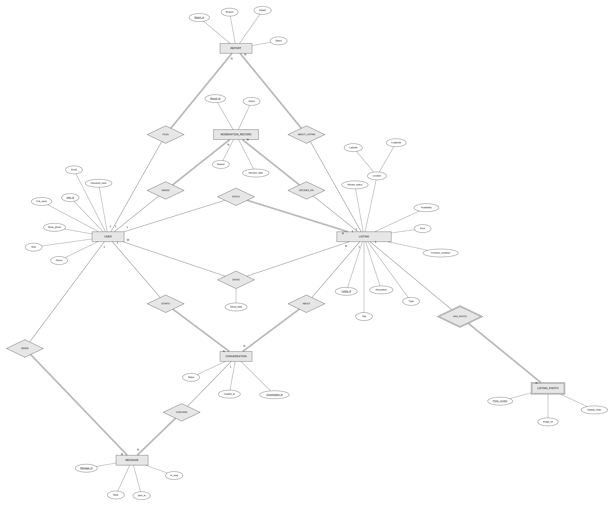
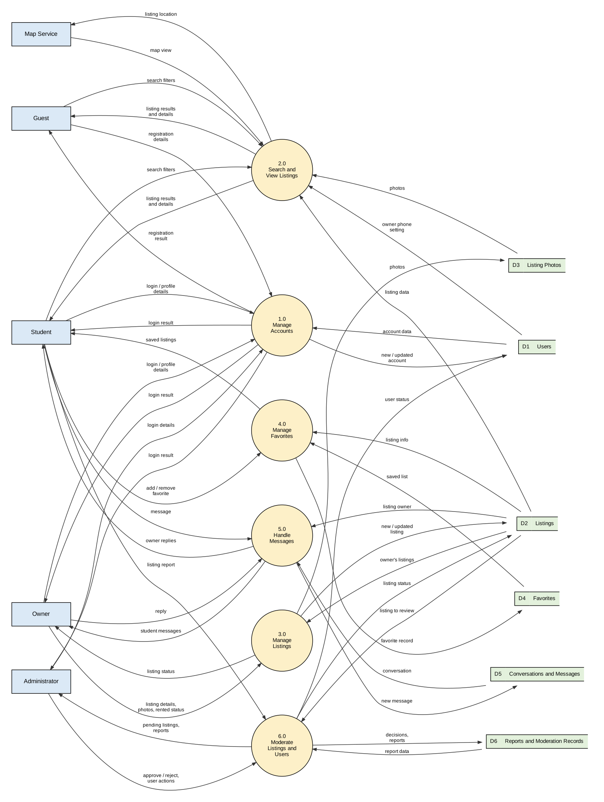
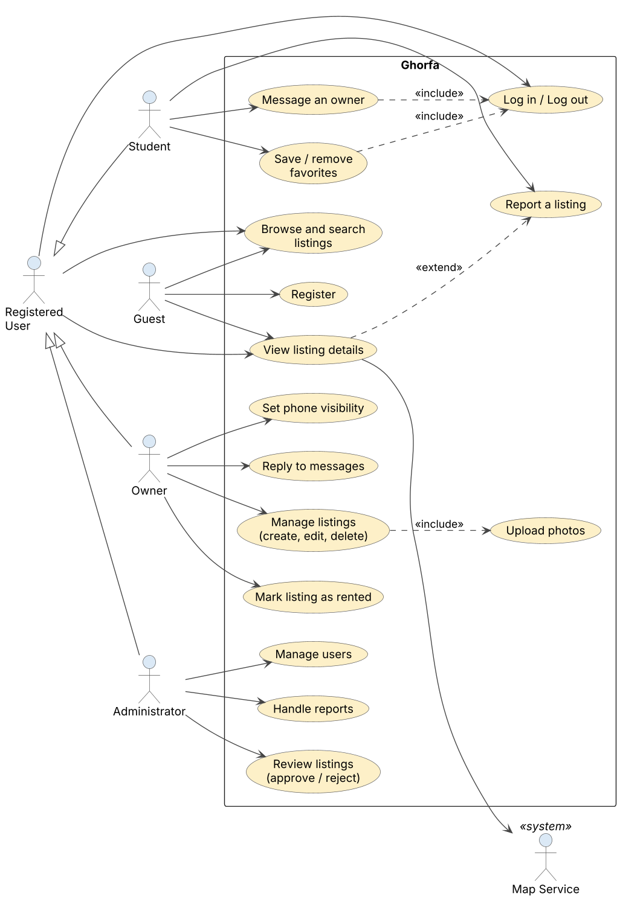
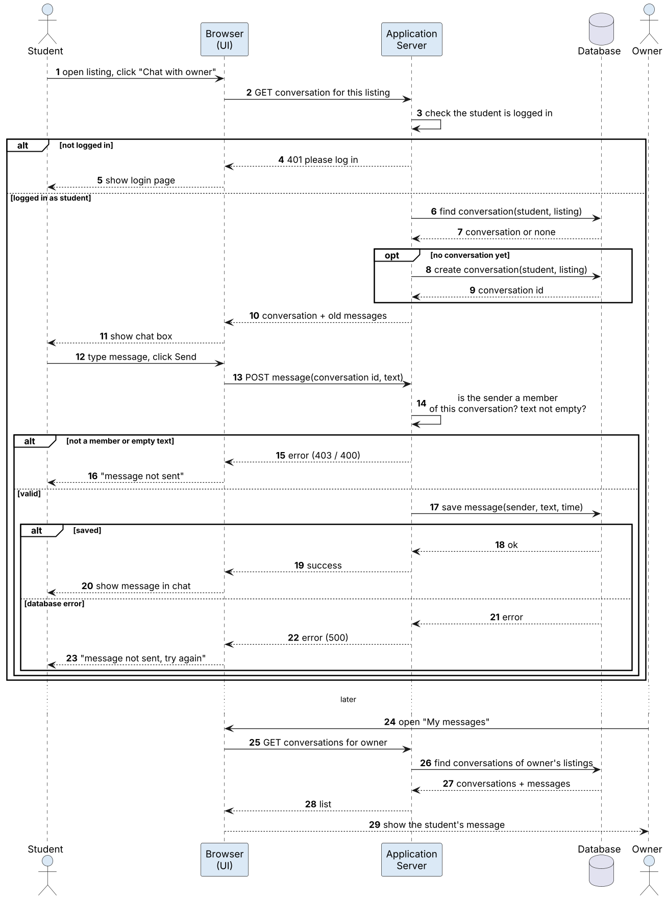
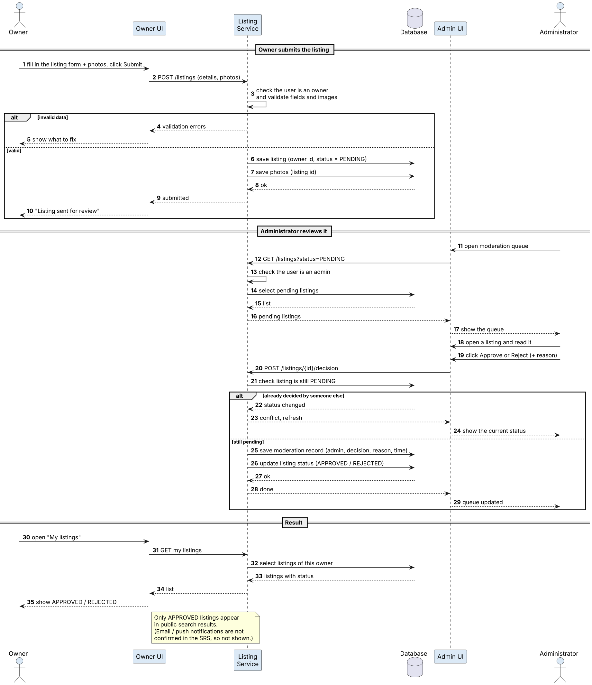

# Ghorfa

Ghorfa ("room" in Arabic) is a web app that helps students find a room or an apartment to rent. Owners post their places with the price, photos, furniture condition and the location on the map, and students search, save and contact them directly. There are no brokers in the middle.

**Course:** Networks and Web Programming, Computer Science Faculty, E-JUST
**Professor:** Ahmed Antar
**TA:** Haidy El-Gharbawy

**Team**

| Name | ID |
| --- | --- |
| Anas Ibrahim Sayed | 320250109 |
| Mazen Mahmoud | 320250094 |
| Malek Khamis | 320250--- |

## Contents

1. [Why we are building this](#why-we-are-building-this)
2. [Current status](#current-status)
3. [Functional requirements](#functional-requirements)
4. [Non-functional requirements](#non-functional-requirements)
5. [Diagrams](#diagrams)
   - [ERD](#1-erd)
   - [DFD level 1](#2-dfd-level-1)
   - [Use case diagram](#3-use-case-diagram)
   - [Sequence diagrams](#4-sequence-diagrams)
6. [Project structure](#project-structure)
7. [How to run it](#how-to-run-it)
8. [To do](#to-do)
9. [Editing the diagrams](#editing-the-diagrams)

## Why we are building this

A lot of students study far from their home city, and the university dorms don't have enough space for everyone. Right now most of them look for a place through Facebook groups, classified sites or friends. The information is scattered, often old, and it's hard to know if an ad is real. Because of this, brokers show up and take fees from both the student and the owner.

What Ghorfa tries to do:

- put all the available rooms in one place
- show the important details in every listing (price, furniture condition, photos, map location)
- let students filter by price, type of place and furniture condition
- let students talk to owners directly
- make it safer with registered owners and an admin who reviews listings

Ghorfa only connects students and owners. Payments and rental contracts are **not** part of the first version, they arrange that between themselves.

There are four kinds of users:

- **Guest**: someone who is not logged in. Can browse and search.
- **Student**: can also save favorites and chat with owners.
- **Owner**: posts and manages listings and answers student messages.
- **Administrator**: approves or rejects listings, manages users and handles reports.

## Current status

Phase 1 is done: the project documentation, the SRS, and the front-end pages.

What exists now:

- Home page, search page (filters + list/map toggle), room details page, login/register page
- A layout that adapts to smaller screens (media queries) with a menu button for mobile, and an EN/Arabic button in the header (the button is only the design for now, it doesn't switch language)

What doesn't exist yet:

- Back end, database and real login
- The pages use hard-coded sample rooms for now (for example "Sunny single room, Hay 4")
- Chat, favorites, owner dashboard and admin panel pages

## Functional requirements

These are what the system must do. Every point has a number so we can refer to it in the diagrams and tests. The full list with the original IDs is in the SRS (`docs/Ghorfa_Software_Requirements_Specification.docx`).

**Accounts**

1. A guest can register as a student or as an owner.
2. The system checks the registration form and does not allow two accounts with the same email.
3. A registered user can log in and log out.
4. After logging in, the user can only reach the pages that fit their role (student, owner or admin).
5. A user can see and edit their profile.
6. A user who forgot their password can recover access.
7. Admin accounts are created by the team. Nobody can register as an admin from the website.

**Searching and browsing**

8. Anyone, even without an account, can browse the published listings.
9. Listings can be filtered by maximum price, type of place (room, apartment, shared room) and furniture condition (furnished, semi-furnished, empty).
10. Filters work together, so the results must match all the selected filters.
11. If nothing matches, the system shows a clear message, and the user can reset the filters.
12. Each result shows at least the title, price, type and whether it is still available.
13. Listings that were not approved by the admin never appear in the results.

**Listing details**

14. The listing page shows the photos, price and rental period, type, furniture condition, description and availability.
15. The listing page shows the location on a map.
16. The owner's phone number is shown only if the owner chose to show it.

**Owner: managing listings**

17. An owner can create a listing with title, description, type, price, furniture condition and location.
18. An owner can upload, remove and replace photos of their listing. The system checks the file type and size.
19. A new listing is sent to the admin for review before the public can see it.
20. An owner can edit or delete their own listings, and only their own.
21. An owner can see the status of each listing (pending, approved, rejected, available, rented).
22. An owner can mark a listing as rented.
23. An owner can choose whether their phone number is visible.

**Favorites**

24. A logged-in student can save a listing, see the saved list and remove a listing from it.
25. The same listing cannot be saved twice by the same student.

**Messages**

26. A logged-in student can start a chat with the owner of a listing.
27. The owner can see the chats and reply.
28. Only the student and the owner of that chat can read it.
29. Each message is saved with its sender, the chat and the time.
30. If a message can't be sent, the user sees an error and not a fake "sent".

**Reports**

31. A user can report a listing that looks fake or misleading and give a reason.

**Administrator**

32. The admin can see the list of listings waiting for review.
33. The admin can approve or reject a listing and write a reason when rejecting.
34. The admin can remove fake or inappropriate listings.
35. The admin can manage user accounts.
36. The admin can read the reports and write down what was decided.
37. The system saves who made each decision and when.

**Optional (maybe later)**

38. Notify the owner about new messages and about the approval or rejection of a listing, and notify the student about owner replies.

## Non-functional requirements

These say how well the system should work, not what it does.

| Area | Requirement |
| --- | --- |
| Performance | Normal pages and searches should load in under 3 seconds for 95% of requests (not counting the map and big images). |
| Performance | Search results use pagination, so we never load all the listings at once. |
| Performance | Listing images are resized so pages don't get slow. |
| Security | Passwords are stored hashed, never as plain text. |
| Security | Roles are checked on the server. Hiding a button in the page is not enough. |
| Security | Before an owner edits or deletes a listing, the server checks that the listing belongs to them. |
| Security | The site runs on HTTPS when deployed. |
| Security | User text and uploaded files are validated to avoid injection and bad files. |
| Security | Too many failed login attempts are limited. Session tokens and passwords never appear in the URL or in logs. |
| Privacy | Phone numbers are public only if the owner allowed it. |
| Privacy | Profiles, favorites and chats are visible only to the people allowed to see them. |
| Privacy | We only collect the data we need. |
| Usability | Navigation, labels and messages look the same on all pages. |
| Usability | Required fields are marked and errors are easy to understand. |
| Usability | Every main page has loading, empty, error and success states. |
| Usability | Buttons and inputs have labels, the text has enough contrast, and the main flows work with the keyboard. |
| Compatibility | Works on the current versions of Chrome, Edge, Firefox and Safari. |
| Compatibility | Usable from 320 px width up (phone, tablet, laptop) without sideways scrolling. |
| Compatibility | Nothing important depends on hover only. |
| Reliability | If something important fails, the user is told. The system never says "done" when it wasn't. |
| Reliability | If the map service is down, the rest of the listing page still works. |
| Reliability | If a photo upload fails, the listing must not pretend that all photos were uploaded. |
| Reliability | We need a backup plan for the data before the real launch. |
| Maintainability | Presentation, logic and data access are kept in separate parts of the code. |
| Maintainability | Same naming style everywhere, and notes on how to set up and deploy. |
| Scalability | Use pagination and indexes so the system can handle more users and listings. |
| Localization | Prices are in Egyptian pounds (EGP). |
| Localization | The interface should be ready for English and Arabic, including right-to-left layout. |

## Diagrams

All the diagrams are in `docs/diagrams/`. Each one is there as PNG, as SVG (better for zooming) and as source so we can edit it.

### 1. ERD

The ERD uses the Chen notation, the same style as the COMPANY example (entities as boxes, attributes as ellipses, relationships as diamonds).



The picture is big, so it is easier to read the [SVG version](docs/diagrams/erd.svg).

How to read it:

- box = entity, double box = weak entity (`LISTING_PHOTO` can't exist without its listing)
- ellipse = attribute, underlined = key, dashed underline = partial key
- ellipse connected to smaller ellipses = composite attribute (`Location` is made of latitude and longitude)
- diamond = relationship, double diamond = identifying relationship
- double line = total participation (every report must belong to a listing, for example)
- 1, N, M = cardinality

Relationships in short:

- one owner **posts** many listings
- one listing **has** many photos
- a student can **save** many listings and a listing can be saved by many students (M:N, with `Saved_date`)
- a student **starts** many conversations, each one is **about** one listing, and it **contains** many messages
- a user **sends** many messages
- a user **files** many reports, and each report is **about** one listing
- an admin **makes** many moderation records, each one **decides on** one listing

Some choices we made to keep it simple:

- There is one `USER` entity with a `Role` (student, owner, admin) and not three separate entities. The SRS leaves this open, and this way is easier.
- The owner of a conversation is not stored again, we get it from the listing.
- Reports are only about listings (the SRS also allows reports about users). The audit event table from the SRS is left out.
- `Review_status` is pending, approved or rejected. `Availability` is available or rented.

If we turn the ERD into tables we get this (PK = primary key, FK = foreign key):

```
USER(user_id PK, full_name, email UNIQUE, password_hash, role, phone, show_phone)
LISTING(listing_id PK, owner_id FK, title, description, type, price,
        furniture_condition, latitude, longitude, review_status, availability)
LISTING_PHOTO(listing_id FK, photo_number, image_url, display_order)   PK = (listing_id, photo_number)
FAVORITE(student_id FK, listing_id FK, saved_date)                      PK = (student_id, listing_id)
CONVERSATION(conversation_id PK, student_id FK, listing_id FK, created_at, status)
MESSAGE(message_id PK, conversation_id FK, sender_id FK, body, sent_at, is_read)
REPORT(report_id PK, reporter_id FK, listing_id FK, reason, details, status)
MODERATION_RECORD(record_id PK, admin_id FK, listing_id FK, action, reason, decision_date)
```

### 2. DFD level 1

Level 1 splits the whole system (the single "Ghorfa" circle in level 0) into its main processes and shows where the data is stored.



- circle = process
- rectangle = external entity (someone or something outside the system)
- open box = data store
- arrows = data flows, with the name of the data on them

| Process | What it does |
| --- | --- |
| 1.0 Manage Accounts | register, log in, profile |
| 2.0 Search and View Listings | filters, results, listing details, map |
| 3.0 Manage Listings | create, edit, photos, mark as rented |
| 4.0 Manage Favorites | save and remove favorites |
| 5.0 Handle Messages | chats between students and owners |
| 6.0 Moderate Listings and Users | review listings, reports, user management |

Data stores: D1 Users, D2 Listings, D3 Listing Photos, D4 Favorites, D5 Conversations and Messages, D6 Reports and Moderation Records.

Note: students and owners can also browse and search, but we only drew Guest and Student on process 2.0 so the diagram doesn't get even more crowded.

### 3. Use case diagram



- Student, Owner and Administrator are all **Registered Users** (the arrows with the empty triangle), so they all log in the same way.
- A guest can only register, browse and view listings.
- "Report a listing" is an `extend` of "View listing details", because the user only does it sometimes.
- "Upload photos" is an `include` of "Manage listings", and "Save favorites" and "Message an owner" include "Log in", because they can't be done without it.
- The map service is an external system used when a listing is shown.

The detailed use case descriptions (main flow, alternative flows, preconditions) are in chapter 9 of the SRS (UC-01 to UC-12).

### 4. Sequence diagrams

We drew the two flows that have the most steps and the most checks.

**A student sends a message to an owner**



**An owner submits a listing and the admin reviews it**



The names like `POST /listings` are only examples to make the diagrams clear. We haven't chosen the back-end technology yet. Notifications are not drawn because they are optional in the SRS (FR 38).

## Project structure

```
.
├── index.html                  home page
├── main.js                     menu button + photo gallery script
├── pages/
│   ├── login.html              login and register
│   ├── search.html             search page with filters
│   └── room.html               room details
├── css/                        base, components, home, search, room, auth
├── imgs/                       logo and illustrations
└── docs/
    ├── Ghorfa_Phase1_Documentation.pdf
    ├── Ghorfa_Software_Requirements_Specification.docx
    └── diagrams/               ERD, DFD, use case, sequence diagrams (+ sources)
```

## How to run it

There is nothing to install for now. The front end is plain HTML, CSS and a little JavaScript, with the Readex Pro font from Google Fonts (so the fonts need internet).

1. Download or clone the project.
2. Open `index.html` in a browser.

## To do

- Move `main.js` into a `js/` folder, or change the script paths. The pages in `pages/` load `../js/main.js`, but the file is in the root folder, and `index.html` does not load it at all. Because of this the menu button and the photo gallery don't work yet.
- `index.html` links to `pages/about.html`, which doesn't exist yet.
- Choose the back end and the database, then build the real login, listings, favorites and chat.
- Build the owner dashboard and the admin panel.
- Choose the map service (the room page only has an "Open in Google Maps" link for now).
- Arabic version and right-to-left layout.

## Editing the diagrams

- `erd.*`: run `python3 make_erd.py` in `docs/diagrams/`. It needs Graphviz and the Python packages `cairosvg` and `Pillow`.
- `dfd_level1.dot`: run `dot -Tpng -Gdpi=110 dfd_level1.dot -o dfd_level1.png` (Graphviz).
- `use_case.puml` and the two `sequence_*.puml` files: open them with [PlantUML](https://plantuml.com) or paste them into the online PlantUML editor.
